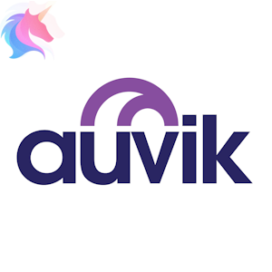
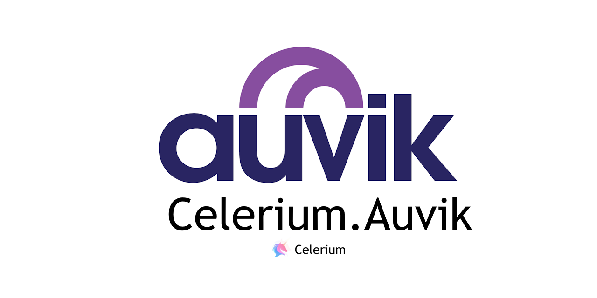

<h1 align="center">
  <br>
  <a href="http://Celerium.org"></a>
  <br>
  Celerium.Auvik
  <br>
</h1>

[![GitHub_CI][GitHub_CI-shield]][GitHub_CI-url]
[![GitHub_Docs][GitHub_Docs-shield]][GitHub_Docs-url]
[![GitHub_PSScriptAnalyzer][GitHub_PSScriptAnalyzer-shield]][GitHub_PSScriptAnalyzer-url]
[![GitHub_Pages][GitHub_Pages-shield]][GitHub_Pages-url]

[![PoshGallery_Version][PoshGallery_Version-shield]][PoshGallery_Version-url]
[![PoshGallery_Platforms][PoshGallery_Platforms-shield]][PoshGallery_Platforms-url]
[![PoshGallery_Downloads][PoshGallery_Downloads-shield]][PoshGallery_Downloads-url]
[![codeSize][codeSize-shield]][codeSize-url]

[![Contributors][contributors-shield]][contributors-url]
[![Forks][forks-shield]][forks-url]
[![Stargazers][stars-shield]][stars-url]
[![Issues][issues-shield]][issues-url]

[![Blog][Website-shield]][Website-url]
[![GitHub_License][GitHub_License-shield]][GitHub_License-url]

---

## Buy me a coffee

Whether you use this project, have learned something from it, or just like it, please consider supporting it by buying me a coffee, so I can dedicate more time on open-source projects like this :)

<a href="https://www.buymeacoffee.com/Celerium" target="_blank"></a>

---

<a name="readme-top"></a>

<!-- PROJECT LOGO -->
<br />
<div align="center">
  <a href="https://celerium.org">
    
  </a>

  <p align="center">
    <a href="https://www.powershellgallery.com/packages/Celerium.Auvik" target="_blank">PowerShell Gallery</a>
    ·
    <a href="https://github.com/Celerium/Celerium.Auvik/issues/new/choose" target="_blank">Report Bug</a>
    ·
    <a href="https://github.com/Celerium/Celerium.Auvik/issues/new/choose" target="_blank">Request Feature</a>
  </p>
</div>

---

## Table of contents

- [About The Project](#about-the-project)
- [Install](#install)
- [Quick Start](#quick-start)
- [Usage](#usage)
- [Function naming](#function-naming)
- [Upgrading from earlier versions](#upgrading-from-earlier-versions)
- [Supported functions](#supported-functions)
- [Cross-platform support](#cross-platform-support)
- [Repository layout](#repository-layout)
- [Keeping the API spec current](#keeping-the-api-spec-current)
- [Build, test, and document](#build-test-and-document)
- [GitHub workflows](#github-workflows)
- [Roadmap](#roadmap)
- [Contributing](#contributing)

## About The Project

The [Celerium.Auvik](https://www.powershellgallery.com/packages/Celerium.Auvik) PowerShell wrapper offers users the ability to extract data from Auvik into third-party reporting tools and aims to abstract away the details of interacting with Auvik's API endpoints in such a way that is consistent with PowerShell nomenclature. This gives system administrators and PowerShell developers a convenient and familiar way of using Auvik's API to create documentation scripts, automation, and integrations.

- :book: Project documentation can be found on [Github Pages](https://celerium.github.io/Celerium.Auvik/)
- :book: Auvik's REST API documentation on their management portal [here](https://auvikapi.us1.my.auvik.com/docs).
- :book: Auvik's [API Integration Guide](https://support.auvik.com/hc/en-us/articles/360031007111-Auvik-API-Integration-Guide) & the list of [available APIs](https://support.auvik.com/hc/en-us/articles/360017965092-Which-APIs-are-available).

Version 2.0.0 of the module supports the Auvik **v1** REST API only (not v2). The 35 public functions are generated from the Auvik OpenAPI spec ([docs/Auvik-v1.json](https://github.com/Celerium/Celerium.Auvik/blob/main/docs/Auvik-v1.json)) so every endpoint of the spec has a function, every query parameter of an endpoint is a function parameter, and the functions are kept up to date when Auvik changes its API.

PowerShell's `verb-noun` nomenclature is respected. Each noun is prefixed with `Auvik` in an attempt to prevent naming problems. For example, one might access the `/inventory/device/info` endpoint by running the following PowerShell command with the appropriate parameters:

```posh
Get-AuvikDeviceInfo -Tenants '1234567890' -FilterDeviceType switch
```

<p align="right">(<a href="#readme-top">back to top</a>)</p>

## Install

This module can be installed directly from the [PowerShell Gallery](https://www.powershellgallery.com/packages/Celerium.Auvik) with the following command:

```posh
Install-Module -Name Celerium.Auvik
```

- :information_source: This module supports Windows PowerShell 5.1 and PowerShell 7+ on Windows, Linux, and macOS.
- :information_source: To install the module from GitHub, download or clone the *main* branch and import the module from the repository, or build it (see [Build, test, and document](#build-test-and-document)) and copy the built module from the `build` folder to a folder in `$env:PSModulePath`:

```posh
git clone https://github.com/Celerium/Celerium.Auvik.git
Import-Module ./Celerium.Auvik/Celerium.Auvik/Celerium.Auvik.psd1
```

Project documentation can be found on [Github Pages](https://celerium.github.io/Celerium.Auvik/)

- A full list of functions can be retrieved by running `Get-Command -Module Celerium.Auvik`.
- Help info and a list of parameters can be found by running `Get-Help <command name>`, such as:

```posh
Get-Help Get-AuvikDeviceInfo
Get-Help Get-AuvikDeviceInfo -Full
```

<p align="right">(<a href="#readme-top">back to top</a>)</p>

## Quick Start

After installing this module, you will need to configure both the *base URI* & *API credentials* that are used to talk with the Auvik API. The Auvik API uses basic authentication where the username is the email address of an Auvik user and the password is an API key. API keys are generated in the Auvik portal, see Auvik's [API Integration Guide](https://support.auvik.com/hc/en-us/articles/360031007111-Auvik-API-Integration-Guide).

1. Run `Add-AuvikBaseURI`
   - By default, Auvik's `https://auvikapi.us1.my.auvik.com/v1` URI is used.
   - Use the `-DataCenter` parameter when your Auvik account lives in another region. The region is part of the URL you use to sign in to Auvik:
      - `Add-AuvikBaseURI -DataCenter eu1`
      - Allowed values: `us1`, `us2`, `us3`, `us4`, `us5`, `us6`, `eu1`, `eu2`, `au1`, `ca1` (`us` & `eu` are aliases of `us1` & `eu1`)
   - `-BaseUri` also accepts the Auvik host you sign in to, such as `Add-AuvikBaseURI -BaseUri us2.my.auvik.com`, which becomes `https://auvikapi.us2.my.auvik.com/v1`.
   - If you have your own API gateway or proxy, you may put in your own custom URI by specifying the `-BaseUri` parameter:
      - `Add-AuvikBaseURI -BaseUri http://myapi.gateway.celerium.org`
   - :warning: A `308 Permanent Redirect` response from the API means the wrong data center is used.
<br>

2. Run `Add-AuvikAPIKey -Username 'user@example.com' -ApiKey 'your-api-key'`
   - `-Username` is the email address of the Auvik user that owns the API key.
   - It will prompt you to enter your API key if you do not specify `-ApiKey`, which keeps the key out of your shell history.
   - A SecureString can be used with `-ApiKeySecureString`.
<br>

3. Verify the connection with `Get-AuvikAuthenticationVerify`
   - The function returns `$true` when the credentials are valid & `$false` when they are not.
<br>

4. [**optional**] Run `Export-AuvikModuleSetting`
   - This will create a config file at `%UserProfile%\Celerium.Auvik\config.psd1` (Windows) or `~/.Celerium.Auvik/config.psd1` (Linux & macOS) that holds the *base uri* & *API key* information.
   - Next time you run `Import-Module -Name Celerium.Auvik`, this configuration file will automatically be loaded. `Import-AuvikModuleSetting` loads it on demand.
   - :warning: Exporting module settings encrypts your API key in a format that can **only be unencrypted by the user principal** that encrypted the secret. It makes use of .NET DPAPI, which for Windows uses reversible encrypted tied to your user principal. This means that you **cannot copy** your configuration file to another computer or user account and expect it to work.
   - :warning: However in Linux\Unix operating systems the secret keys are more obfuscated than encrypted so it is recommend to use a more secure & cross-platform storage method.

```posh
Add-AuvikBaseURI -DataCenter us1
Add-AuvikAPIKey -Username 'user@example.com'
Get-AuvikAuthenticationVerify
```

### Environment variables

The following environment variables configure the module automatically when it is imported. They take priority over the saved configuration file, which makes them a good fit for automation such as GitHub Actions or containers:

|Environment variable|Description                                                        |
|--------------------|-------------------------------------------------------------------|
|`AUVIK_BASE_URI`    |The base URI of the API, such as `https://auvikapi.us2.my.auvik.com/v1`. An Auvik host such as `us2.my.auvik.com` is converted to the API base URI|
|`AUVIK_USERNAME`    |The API username (email address)                                   |
|`AUVIK_API_KEY`     |The API key                                                        |

```posh
$env:AUVIK_BASE_URI = 'https://auvikapi.us2.my.auvik.com/v1'
$env:AUVIK_USERNAME = 'user@example.com'
$env:AUVIK_API_KEY  = Read-Host -Prompt 'Auvik API key'
Import-Module Celerium.Auvik
```

The live tests (see [Build, test, and document](#build-test-and-document)) additionally use `AUVIK_SITE_NAME`, the exact display name of the one Auvik tenant the read-only live tests may touch.

:warning: Never store an API key in a script or commit one to a repository.

<p align="right">(<a href="#readme-top">back to top</a>)</p>

## Usage

Calling an API resource is as simple as running `Get-Auvik<resourceName>`. Every function responds with the [JSON:API](https://jsonapi.org) object that Auvik's API provides, so the results are found in the following properties:

- `data` - The actual information requested (this is what most people care about)
- `included` - Related resources when an `-Include` parameter is used
- `links` - Links to the next, previous, first, & last page of results
- `meta` - Extra information such as the number of pages

### Tenants

Most Auvik endpoints return data of every tenant (client) that you have access to. The Auvik best practice is to scope requests to a tenant with the `-Tenants` parameter, which accepts one or more tenant IDs.

```posh
# Tenants the user has access to
$Tenants = Get-AuvikTenant
$Tenants.data | Select-Object id -ExpandProperty attributes

# Tenant details (display names). The domain prefix of the main Auvik account is required
$Details = Get-AuvikTenantDetail -TenantDomainPrefix 'mspdemo'
$TenantId = ($Details.data | Where-Object { $_.attributes.displayName -eq 'Contoso' }).id
```

### Reading data

Functions that read a collection and a single item are merged into one function with the parameter sets `List` & `ById`.

```posh
# List devices of one tenant using filters
Get-AuvikDeviceInfo -Tenants $TenantId -FilterDeviceType switch -FilterOnlineStatus offline

# A single device
Get-AuvikDeviceInfo -Id 'device-id'

# Include related resources & limit their fields
Get-AuvikDeviceInfo -Tenants $TenantId -Include deviceDetail -FieldsDeviceDetail interfaces

# Alerts of one tenant that are not dismissed
Get-AuvikAlertHistory -Tenants $TenantId -FilterSeverity critical -FilterDismissed $false

# Statistics for the last 24 hours
Get-AuvikDeviceStatistics -StatId cpuUtilization -FilterFromTime (Get-Date).AddHours(-24) -FilterInterval hour -Tenants $TenantId
```

- Query parameters use the PascalCase name of the API parameter: `filter[deviceType]` is `-FilterDeviceType`, `page[first]` is `-PageFirst`, & `tenants` is `-Tenants` (`string[]`).
- Parameters of the API that take a boolean are `[bool]` parameters, such as `-FilterDismissed $false`.
- Date & time parameters accept a `[datetime]` that is sent to the API in UTC.
- Parameters with a fixed list of values support tab completion & are validated.

### Pagination & `-AllResults`

The Auvik API returns paged results. Use the `-PageFirst`, `-PageAfter`, `-PageLast`, & `-PageBefore` parameters to page manually, or use `-AllResults` on a paged endpoint to follow the pagination links & return every item in a single object:

```posh
$Devices = Get-AuvikDeviceInfo -Tenants $TenantId -FilterDeviceType server -AllResults
$Devices.data.Count
```

- With `-AllResults` the `data` (and `included`) properties hold the items of every page & the `links` & `meta` properties are `$null`.
- :warning: Use `-AllResults` together with filters and a single tenant to reduce API errors & timeouts.
- Auvik limits the API to **2500 requests per 5 minutes**. The module retries requests that are rate limited (`429`) or fail with a temporary server error with an exponential back off.

### Writing data

The Auvik v1 API has a single write endpoint, dismissing an alert. Write functions support `-WhatIf` & `-Confirm` (`ConfirmImpact = 'High'`, so PowerShell asks for confirmation by default) and a failed write request is never retried:

```posh
Send-AuvikAlertDismiss -Id 'alert-id' -WhatIf
Send-AuvikAlertDismiss -Id 'alert-id'
```

### Examples

The [examples](https://github.com/Celerium/Celerium.Auvik/tree/main/examples) folder contains scripts that work in Windows PowerShell 5.1 and PowerShell 7+ on Windows, Linux, & macOS. They are read-only and only query one tenant.

|Example                                                                                   |Description                                                    |
|------------------------------------------------------------------------------------------|---------------------------------------------------------------|
|[Connect-AuvikExample.ps1](examples/Connect-AuvikExample.ps1)                             |Configure the credentials & data center, verify the connection |
|[Get-DeviceInventoryExample.ps1](examples/Get-DeviceInventoryExample.ps1)                 |Export the devices of a tenant to a CSV file                   |
|[Get-AlertReportExample.ps1](examples/Get-AlertReportExample.ps1)                         |Summarize alerts by severity & status                          |
|[Get-DeviceStatisticsExample.ps1](examples/Get-DeviceStatisticsExample.ps1)               |Summarize CPU utilization for the last 24 hours                |
|[Get-DeviceLifecycleExample.ps1](examples/Get-DeviceLifecycleExample.ps1)                 |Combined device lifecycle & warranty report                    |

:warning: [examples/Legacy/Get-AlertReportExample.ps1](examples/Legacy/Get-AlertReportExample.ps1) is marked **LEGACY - WRITES DATA**: with `-Dismiss` it dismisses alerts. It is kept for reference only.

<p align="right">(<a href="#readme-top">back to top</a>)</p>

## Function naming

Function names are generated from the HTTP method of an endpoint. In order to maintain PowerShell best practices, only approved verbs are used.

|HTTP method|PowerShell verb|Example                                       |
|-----------|---------------|----------------------------------------------|
|GET        |`Get-`         |`Get-AuvikDeviceInfo`                         |
|POST       |`Send-`        |`Send-AuvikAlertDismiss`                       |
|PUT / PATCH|`Set-`         |*(none in the Auvik v1 API at this time)*     |
|DELETE     |`Remove-`      |*(none in the Auvik v1 API at this time)*     |

- Each noun is prefixed with `Auvik` & is built from the endpoint, such as `/inventory/device/detail/extended` -> `Get-AuvikDeviceDetailExtended`.
- All parameters & variables are PascalCase.
- Any function that is not a read-only `Get-` function is a *write* function & supports `-WhatIf` & `-Confirm`.
- Table entries marked with *none* are supported by the generator, but the Auvik v1 API does not have such an endpoint right now.

<p align="right">(<a href="#readme-top">back to top</a>)</p>

## Upgrading from earlier versions

Version 2.0.0 regenerated the public functions from the Auvik spec. The names of earlier versions still work as aliases of the new functions:

|Earlier function (alias)         |New function                        |
|---------------------------------|------------------------------------|
|`Get-AuvikDevice`                |`Get-AuvikDeviceInfo`               |
|`Get-AuvikInterface`             |`Get-AuvikInterfaceInfo`            |
|`Get-AuvikComponent`             |`Get-AuvikComponentInfo`            |
|`Get-AuvikNetwork`               |`Get-AuvikNetworkInfo`              |
|`Get-AuvikEntity`                |`Get-AuvikEntityNote`               |
|`Get-AuvikAlert`                 |`Get-AuvikAlertHistory`             |
|`Clear-AuvikAlert`               |`Send-AuvikAlertDismiss`             |
|`Get-AuvikBilling`               |`Get-AuvikBillingUsageClient`       |
|`Get-AuvikSNMPPollerHistory`     |`Get-AuvikSNMPPollerHistoryString`  |
|`Test-AuvikAPICredential`        |`Get-AuvikAuthenticationVerify` (returns `$true` / `$false`) |
|`Set-AuvikAPIKey`                |`Add-AuvikAPIKey`                   |
|`Set-AuvikBaseURI`               |`Add-AuvikBaseURI`                  |

Things to be aware of when you upgrade:

- Parameters changed to match the API. `-ID` is now `-Id`, query parameters are PascalCase names of the API parameters (`-FilterDeviceType`, `-PageFirst`, `-Tenants`, ...), & switches became `[bool]` parameters where the API takes a boolean. Review scripts that call the aliases.
- The switches that selected a different endpoint are now separate functions:

|Earlier function & switch            |New function                                                  |
|-------------------------------------|--------------------------------------------------------------|
|`Get-AuvikDevice -AgentDetail`              |`Get-AuvikDeviceDetail`                                 |
|`Get-AuvikDevice -AgentExtended`            |`Get-AuvikDeviceDetailExtended`                         |
|`Get-AuvikDevice -AgentInfo`                |`Get-AuvikDeviceInfo` (or the `Get-AuvikDevice` alias)  |
|`Get-AuvikNetwork -NetworkDetails`          |`Get-AuvikNetworkDetail`                                |
|`Get-AuvikEntity -Audits`                   |`Get-AuvikEntityAudit`                                  |
|`Get-AuvikEntity -Notes`                    |`Get-AuvikEntityNote` (or the `Get-AuvikEntity` alias)  |
|`Get-AuvikTenant -TenantDomainPrefix`       |`Get-AuvikTenantDetail -TenantDomainPrefix`             |
|`Get-AuvikBilling -ID`                      |`Get-AuvikBillingUsageDevice -Id`                       |
|`Get-AuvikSNMPPollerHistory -FilterInterval`|`Get-AuvikSNMPPollerHistoryInt -FilterInterval`         |

- The filters that belong to the detail endpoints moved with them, for example `-FilterManageStatus`, `-FilterDiscoverySNMP`, & `-FilterTrafficInsightsStatus` are parameters of `Get-AuvikDeviceDetail`, & `-FilterScope` is a parameter of `Get-AuvikNetworkDetail`.
- `Send-AuvikAlertDismiss` (alias `Clear-AuvikAlert`) now asks for confirmation by default (`ConfirmImpact = 'High'`). Use `-Confirm:$false` in automation.

- Responses are the JSON:API object of the API (`data`, `included`, `links`, `meta`).
- Run `Get-Help <function> -Full` to see the parameters of a function.

<p align="right">(<a href="#readme-top">back to top</a>)</p>

## Supported functions

The following is a table of the public functions and their corresponding API resources. Functions with two resources use the parameter sets `List` & `ById`. The complete list of endpoints and the status of each is tracked in [docs/endpoints.csv](https://github.com/Celerium/Celerium.Auvik/blob/main/docs/endpoints.csv).

|Section         |Function                              |Method|API Resource                                                                 |
|----------------|--------------------------------------|------|-----------------------------------------------------------------------------|
|alert           |`Get-AuvikAlertHistory`               |GET   |`/alert/history/info`<br>`/alert/history/info/{id}`                          |
|alert           |`Send-AuvikAlertDismiss`               |POST  |`/alert/dismiss/{id}`                                                        |
|billing         |`Get-AuvikBillingUsageClient`         |GET   |`/billing/usage/client`                                                      |
|billing         |`Get-AuvikBillingUsageDevice`         |GET   |`/billing/usage/device/{id}`                                                 |
|clientManagement|`Get-AuvikTenant`                     |GET   |`/tenants`                                                                   |
|clientManagement|`Get-AuvikTenantDetail`               |GET   |`/tenants/detail`<br>`/tenants/detail/{id}`                                  |
|inventory       |`Get-AuvikComponentInfo`              |GET   |`/inventory/component/info`<br>`/inventory/component/info/{id}`              |
|inventory       |`Get-AuvikConfiguration`              |GET   |`/inventory/configuration`<br>`/inventory/configuration/{id}`                |
|inventory       |`Get-AuvikDeviceDetail`               |GET   |`/inventory/device/detail`<br>`/inventory/device/detail/{id}`                |
|inventory       |`Get-AuvikDeviceDetailExtended`       |GET   |`/inventory/device/detail/extended`<br>`/inventory/device/detail/extended/{id}`|
|inventory       |`Get-AuvikDeviceInfo`                 |GET   |`/inventory/device/info`<br>`/inventory/device/info/{id}`                    |
|inventory       |`Get-AuvikDeviceLifecycle`            |GET   |`/inventory/device/lifecycle`<br>`/inventory/device/lifecycle/{id}`          |
|inventory       |`Get-AuvikDeviceWarranty`             |GET   |`/inventory/device/warranty`<br>`/inventory/device/warranty/{id}`            |
|inventory       |`Get-AuvikEntityAudit`                |GET   |`/inventory/entity/audit`<br>`/inventory/entity/audit/{id}`                  |
|inventory       |`Get-AuvikEntityNote`                 |GET   |`/inventory/entity/note`<br>`/inventory/entity/note/{id}`                    |
|inventory       |`Get-AuvikInterfaceInfo`              |GET   |`/inventory/interface/info`<br>`/inventory/interface/info/{id}`              |
|inventory       |`Get-AuvikNetworkDetail`              |GET   |`/inventory/network/detail`<br>`/inventory/network/detail/{id}`              |
|inventory       |`Get-AuvikNetworkInfo`                |GET   |`/inventory/network/info`<br>`/inventory/network/info/{id}`                  |
|other           |`Get-AuvikAuthenticationVerify`       |GET   |`/authentication/verify`                                                     |
|pollers         |`Get-AuvikSNMPPollerDevice`           |GET   |`/settings/snmppoller/{snmpPollerSettingId}/devices`                         |
|pollers         |`Get-AuvikSNMPPollerHistoryInt`       |GET   |`/stat/snmppoller/int`                                                       |
|pollers         |`Get-AuvikSNMPPollerHistoryString`    |GET   |`/stat/snmppoller/string`                                                    |
|pollers         |`Get-AuvikSNMPPollerSetting`          |GET   |`/settings/snmppoller`<br>`/settings/snmppoller/{snmpPollerSettingId}`       |
|statistics      |`Get-AuvikComponentStatistics`        |GET   |`/stat/component/{componentType}/{statId}`                                   |
|statistics      |`Get-AuvikDeviceAvailabilityStatistics`|GET  |`/stat/deviceAvailability/{statId}`                                          |
|statistics      |`Get-AuvikDeviceStatistics`           |GET   |`/stat/device/{statId}`                                                      |
|statistics      |`Get-AuvikInterfaceStatistics`        |GET   |`/stat/interface/{statId}`                                                   |
|statistics      |`Get-AuvikOIDStatistics`              |GET   |`/stat/oid/{statId}`                                                         |
|statistics      |`Get-AuvikServiceStatistics`          |GET   |`/stat/service/{statId}`                                                     |
|saasManagement  |`Get-AuvikASMApplication`             |GET   |`/asm/app/info`                                                              |
|saasManagement  |`Get-AuvikASMClient`                  |GET   |`/asm/client/info`                                                           |
|saasManagement  |`Get-AuvikASMLicense`                 |GET   |`/asm/license/info`                                                          |
|saasManagement  |`Get-AuvikASMSecurityLog`             |GET   |`/asm/securityLog/info`                                                      |
|saasManagement  |`Get-AuvikASMTag`                     |GET   |`/asm/tag/info`                                                              |
|saasManagement  |`Get-AuvikASMUser`                    |GET   |`/asm/user/info`                                                             |

The module also exports the functions used to configure it: `Add-AuvikAPIKey`, `Get-AuvikAPIKey`, `Remove-AuvikAPIKey`, `Add-AuvikBaseURI`, `Get-AuvikBaseURI`, `Remove-AuvikBaseURI`, `Export-AuvikModuleSetting`, `Import-AuvikModuleSetting`, `Get-AuvikModuleSetting`, & `Remove-AuvikModuleSetting`.

<p align="right">(<a href="#readme-top">back to top</a>)</p>

## Cross-platform support

The module and its tests are built and tested on:

- Windows PowerShell 5.1
- PowerShell 7+ on Windows
- PowerShell 7+ on Linux
- PowerShell 7+ on macOS

The code avoids features that only exist in newer versions of PowerShell, so it behaves the same everywhere. The exception is saving the module settings: the API key is only encrypted on Windows (DPAPI), see [Quick Start](#quick-start).

<p align="right">(<a href="#readme-top">back to top</a>)</p>

## Repository layout

|Path                    |Description                                                                                                  |
|------------------------|-------------------------------------------------------------------------------------------------------------|
|`Celerium.Auvik/`       |The module source. `Public` holds the **generated** functions, `Private` holds the hand written helpers      |
|`build/`                |Scripts to install prerequisites, generate the functions, build, test, document, & publish the module. The built module (`build/Celerium.Auvik/<version>/`) contains the `.psd1`, a single `.psm1`, & the spec |
|`docs/`                 |The GitHub pages documentation, the Auvik spec (`Auvik-v1.json`), & the endpoint tracking file (`endpoints.csv`)|
|`examples/`             |Example scripts that use the module                                                                          |
|`tests/`                |The Pester tests                                                                                             |
|`.github/`              |GitHub workflows, issue templates, the contributing guide, & other community files                          |

<p align="right">(<a href="#readme-top">back to top</a>)</p>

## Keeping the API spec current

The public functions are generated from the Auvik OpenAPI spec, so they should never be edited by hand. The scripts in the `build` folder keep them current (PowerShell 7+ is needed to generate the functions):

|Script                      |Description                                                                                          |
|----------------------------|-----------------------------------------------------------------------------------------------------|
|`Get-AuvikSpec.ps1`     |Downloads the online spec (`https://auvikapi.us1.my.auvik.com/spec`) to `docs/Auvik-v1.json`, a different existing spec is copied to `build/Archive/` first|
|`Compare-AuvikSpec.ps1`  |Compares the local spec to the online spec & lists the endpoints & schemas that changed              |
|`New-PublicFunctions.ps1`   |Regenerates the public functions, the export lists of the module manifest, & `docs/endpoints.csv`    |

```posh
./build/Compare-AuvikSpec.ps1
./build/Get-AuvikSpec.ps1
./build/New-PublicFunctions.ps1
```

To change how a function looks, change `build/New-PublicFunctions.ps1` and run it again instead of editing the functions. The [API spec workflow](#github-workflows) runs the comparison every week.

<p align="right">(<a href="#readme-top">back to top</a>)</p>

## Build, test, and document

The scripts in the `build` folder work on Windows PowerShell 5.1 and PowerShell 7+ on Windows, Linux, & macOS (generating the functions requires PowerShell 7+).

```posh
# Install ModuleBuilder, Pester, PSScriptAnalyzer, & Microsoft.PowerShell.PlatyPS
./build/Install-Prerequisites.ps1

# Build the module to build/Celerium.Auvik/<version>
./build/Invoke-ModuleBuild.ps1 -Version 2.0.0

# Run the Pester tests against the source module or the built module
./build/Invoke-PesterTests.ps1 -Version 2.0.0 -BuildTarget notBuilt
./build/Invoke-PesterTests.ps1 -Version 2.0.0 -BuildTarget built

# Update the markdown documentation in docs/
./build/Invoke-HelpContent.ps1
```

- The tests require Pester 6 or later & include PSScriptAnalyzer tests & help (comment based help) tests.
- Unit tests never reach a real API: every request is mocked & a fallback mock throws on any request that is not.
- Tests tagged `Live` make real read-only (GET) requests against Auvik and `Online` tests download the online spec. Both are excluded by default. To run the live tests set `AUVIK_USERNAME`, `AUVIK_API_KEY`, optionally `AUVIK_BASE_URI`, & optionally `AUVIK_SITE_NAME` (the exact display name of the one tenant the data tests may read; without it only the credentials & tenant list are read), then run `./build/Invoke-PesterTests.ps1 -Version 2.0.0 -BuildTarget built -IncludeTag Live -ExcludeTag Online`. The live requests are spaced 500 ms apart & limited to 60 per run.
- `docs/index.md`, `docs/Celerium.Auvik.md`, `docs/TrackingCSV.md`, & the pages in `docs/site` are generated from this README, the tracking CSV, & the help of the functions by `Invoke-HelpContent.ps1`.
- `Publish-CeleriumModule.ps1` publishes a built module to the PowerShell Gallery, the release workflow normally does this.

<p align="right">(<a href="#readme-top">back to top</a>)</p>

## GitHub workflows

Azure Pipelines is no longer used, all automation runs in [GitHub Actions](https://github.com/Celerium/Celerium.Auvik/actions) (`.github/workflows`):

|Workflow         |File             |Description                                                                                                    |
|-----------------|-----------------|---------------------------------------------------------------------------------------------------------------|
|CI               |`ci.yml`         |Checks that the generated code is up to date, builds the module, & runs the Pester tests on Windows PowerShell 5.1, Windows PowerShell 7+, Linux, & macOS|
|Documentation    |`docs.yml`       |Regenerates the GitHub pages documentation in `docs/`                                                          |
|Release          |`release.yml`    |Builds, tests, & publishes the module to the PowerShell Gallery when a version tag such as `v2.0.0` is pushed  |
|PSScriptAnalyzer |`powershell.yml` |Runs PSScriptAnalyzer & uploads the results to GitHub code scanning                                            |
|API spec         |`api-spec.yml`   |Weekly comparison of `docs/Auvik-v1.json` with the online Auvik spec                                           |

<p align="right">(<a href="#readme-top">back to top</a>)</p>

## Roadmap

- [x] Add example scripts & automation
- [x] Build more robust Pester & ScriptAnalyzer tests
- [x] Figure out how to do CI & PowerShell gallery automation
- [x] Generate the public functions from the Auvik OpenAPI spec
- [x] Support Windows PowerShell 5.1 and PowerShell 7+ on Windows, Linux, & macOS
- [ ] Add Changelog

See the [open issues](https://github.com/Celerium/Celerium.Auvik/issues) for a full list of proposed features (and known issues).

<p align="right">(<a href="#readme-top">back to top</a>)</p>

---

## Contributing

Contributions are what makes the open-source community such an amazing place to learn, inspire, and create. Any contributions you make are **greatly appreciated**.

If you have a suggestion that would make this better, please fork the repo and create a pull request. You can also simply open an issue with the tag "enhancement".
Don't forget to give the project a star! Thanks again!

See the [CONTRIBUTING](https://github.com/Celerium/Celerium.Auvik/blob/main/.github/CONTRIBUTING.md) guide for more information about contributing, including how the generated functions, the build, & the tests work.

<p align="right">(<a href="#readme-top">back to top</a>)</p>

## License

Distributed under the MIT License. See [`LICENSE`](https://github.com/Celerium/Celerium.Auvik/blob/main/LICENSE) for more information.

[![GitHub_License][GitHub_License-shield]][GitHub_License-url]

<p align="right">(<a href="#readme-top">back to top</a>)</p>

## Contact

<div align="left">

  <p align="left">
    ·
    <a href="https://celerium.org/#/contact" target="_blank">Website</a>
    ·
    <a href="mailto: celerium@celerium.org">Email</a>
    ·
    <a href="https://www.reddit.com/user/CeleriumIO" target="_blank">Reddit</a>
    ·
  </p>
</div>

<p align="right">(<a href="#readme-top">back to top</a>)</p>

## Acknowledgments

Big thank you to the following people and services as they have provided me with lots of helpful information as I continue this project!

- [GitHub Pages](https://pages.github.com)
- [Img Shields](https://shields.io)
- [Font Awesome](https://fontawesome.com)
- [Choose an Open Source License](https://choosealicense.com)
- [GitHub Emoji Cheat Sheet](https://www.webpagefx.com/tools/emoji-cheat-sheet)

<p align="right">(<a href="#readme-top">back to top</a>)</p>

<!-- MARKDOWN LINKS & IMAGES -->
<!-- https://www.markdownguide.org/basic-syntax/#reference-style-links -->

[GitHub_CI-shield]:                 https://github.com/Celerium/Celerium.Auvik/actions/workflows/ci.yml/badge.svg
[GitHub_CI-url]:                    https://github.com/Celerium/Celerium.Auvik/actions/workflows/ci.yml

[GitHub_Docs-shield]:               https://github.com/Celerium/Celerium.Auvik/actions/workflows/docs.yml/badge.svg
[GitHub_Docs-url]:                  https://github.com/Celerium/Celerium.Auvik/actions/workflows/docs.yml

[GitHub_PSScriptAnalyzer-shield]:   https://github.com/Celerium/Celerium.Auvik/actions/workflows/powershell.yml/badge.svg
[GitHub_PSScriptAnalyzer-url]:      https://github.com/Celerium/Celerium.Auvik/actions/workflows/powershell.yml

[GitHub_Pages-shield]:              https://img.shields.io/github/actions/workflow/status/celerium/Celerium.Auvik/pages%2Fpages-build-deployment?style=for-the-badge&label=GitHub%20Pages
[GitHub_Pages-url]:                 https://github.com/Celerium/Celerium.Auvik/actions/workflows/pages/pages-build-deployment

[GitHub_License-shield]:            https://img.shields.io/github/license/celerium/Celerium.Auvik?style=for-the-badge
[GitHub_License-url]:               https://github.com/Celerium/Celerium.Auvik/blob/main/LICENSE

[PoshGallery_Version-shield]:       https://img.shields.io/powershellgallery/v/Celerium.Auvik?include_prereleases&style=for-the-badge
[PoshGallery_Version-url]:          https://www.powershellgallery.com/packages/Celerium.Auvik

[PoshGallery_Platforms-shield]:     https://img.shields.io/powershellgallery/p/Celerium.Auvik?style=for-the-badge
[PoshGallery_Platforms-url]:        https://www.powershellgallery.com/packages/Celerium.Auvik

[PoshGallery_Downloads-shield]:     https://img.shields.io/powershellgallery/dt/Celerium.Auvik?style=for-the-badge
[PoshGallery_Downloads-url]:        https://www.powershellgallery.com/packages/Celerium.Auvik

[website-shield]:                   https://img.shields.io/website?up_color=blue&url=https%3A%2F%2Fcelerium.org&style=for-the-badge&label=Blog
[website-url]:                      https://celerium.org

[codeSize-shield]:                  https://img.shields.io/github/repo-size/celerium/Celerium.Auvik?style=for-the-badge
[codeSize-url]:                     https://github.com/Celerium/Celerium.Auvik

[contributors-shield]:              https://img.shields.io/github/contributors/celerium/Celerium.Auvik?style=for-the-badge
[contributors-url]:                 https://github.com/Celerium/Celerium.Auvik/graphs/contributors

[forks-shield]:                     https://img.shields.io/github/forks/celerium/Celerium.Auvik?style=for-the-badge
[forks-url]:                        https://github.com/Celerium/Celerium.Auvik/network/members

[stars-shield]:                     https://img.shields.io/github/stars/celerium/Celerium.Auvik?style=for-the-badge
[stars-url]:                        https://github.com/Celerium/Celerium.Auvik/stargazers

[issues-shield]:                    https://img.shields.io/github/issues/Celerium/Celerium.Auvik?style=for-the-badge
[issues-url]:                       https://github.com/Celerium/Celerium.Auvik/issues
